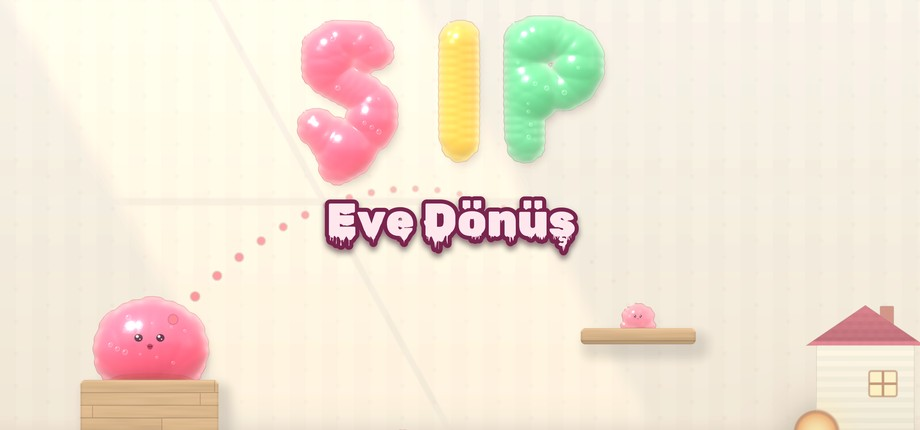
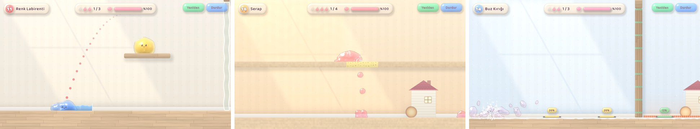

# Merhaba, ben Baki 👋

Kırıkkale Üniversitesi **Bilgisayar** son sınıf öğrencisiyim (mezuniyet: 2026).
Mobil ve oyun tarafında, tek kod tabanından birden fazla platforma çıkan ürünler geliştiriyorum.

## 🚀 Yayında olanlar

Dördü de şu anda yayında: üçü tarayıcıda açılıyor, Şıp Windows için ücretsiz indirilebiliyor.

### 🫧 [Şıp: Eve Dönüş](https://bakibacaci.itch.io/plip) — slime fizik bulmaca oyunu
`Unity 6` · `C#` · `HLSL shader` · `URP 2D` · `UI Toolkit`

Evine dönmeye çalışan yapışkan bir slime'ı tutup gerip fırlatıyorsun. Slime yüzlerce parçacıktan oluşan gerçek bir yapışkan sıvı olarak hesaplanıyor ve özel shader'larla üç boyutlu bir jöle gibi çiziliyor. Tahtaya yapışıyor, ızgaradan bal gibi süzülüyor, karda donup kırılıyor, güneşte eriyor, boyalarla renk değiştirip karışıyor.

- **Kendi fizik motoru:** viskoelastik parçacık simülasyonu (yapışma, plastik yaylar, viskozite, sıcaklık, renk karışımı), Unity'den bağımsız C# kütüphanesi
- **Kendi çizim hattı:** parçacıklardan yükseklik alanı, kırılma, ışık ve yüzey ifadeleri üreten HLSL shader'lar; arayüz de aynı jöle görünümüyle koddan kuruluyor
- **5 dünya, 24 bulmaca:** her bölüm bir "aha" fikri üzerine; çözülebilirlik ve par sayıları kendi yazdığım ışın aramalı (beam search) bölüm çözücüsüyle doğrulanıyor
- **Bölüm düzenleyici** ve paylaşım kodları, 19 başarım, kostüm dolabı, Türkçe ve İngilizce
- **Mağaza görselleri oyunun kendi motoruyla üretiliyor:** kapsüller, logo ve ekran görüntülerini çeken otomatik bir yakalama modu

▶️ **[itch.io'dan indir](https://bakibacaci.itch.io/plip)** (Windows, ücretsiz)

### 🎲 [Blöf](https://blof-64f01.web.app) — çok oyunculu parti oyunu
`Expo (React Native)` · `TypeScript` · `Firebase Realtime Database` · `Firebase Hosting`

Arkadaş grubuyla telefondan oynanan Türkçe blöf/tahmin oyunu. Herkes kendi telefonundan aynı odaya girer; soruya uydurma cevaplar yazılır, hem gerçeği bulmaya hem diğerlerini kandırmaya çalışılır. Web sürümü asıl davet kanalı: arkadaşına link atarsın, hiçbir şey indirmeden odaya girer.

- Tek kod tabanı, üç hedef: **iOS, Android, tarayıcı**
- Gerçek zamanlı: canlı lobi, anonim giriş, kod veya linkle katılma, çevrimdışı oyuncu takibi
- **Dört mod uçtan uca oynanıyor:** Yalan Avcısı · Kral · Buluşma · Mezat
- 275 soruluk Türkçe içerik havuzu, altı kategori
- Arayüz tasarımı, tipografi ve oyun içi metinlerin tamamı bana ait

▶️ **[Oyna](https://blof-64f01.web.app)** &nbsp;·&nbsp; 📦 **[Kaynak kod](https://github.com/BakiBacaci/blof-oyun)**

### 📱 [Elver](https://bakibacaci.github.io/elver_app/)
`Flutter` · `Dart` — Özgün konseptli, baştan sona bağımsız geliştirdiğim mobil uygulama. Web sürümü yayında.
📦 [Kaynak kod](https://github.com/BakiBacaci/elver_app)

### 📱 [Memento](https://bakibacaci.github.io/memento/)
`Flutter` · `Dart` — Mobil uygulama, web sürümü yayında.
📦 [Kaynak kod](https://github.com/BakiBacaci/memento)

## 🛠 Kullandıklarım

**Mobil** — React Native (Expo) · Flutter · Dart · Android Studio
**Web ve diller** — TypeScript · JavaScript · C# · Java · Python · HTML · CSS
**Veri ve servis** — Firebase (Realtime Database, Authentication, Hosting) · SQL
**Oyun** — Unity (URP, UI Toolkit) · C# · HLSL shader · parçacık fiziği
**Araçlar** — Git · Expo CLI · Firebase CLI · Visual Studio · VS Code · itch.io butler

Yapay zekâ araçlarını kod yazma, hata ayıklama, araştırma ve görsel üretiminde günlük iş akışımın parçası olarak kullanıyorum.

## 📫 İletişim

[bakibacaci05@gmail.com](mailto:bakibacaci05@gmail.com) &nbsp;·&nbsp; [LinkedIn](https://linkedin.com/in/bakibacaci)

Tam zamanlı çalışmaya, uzaktan çalışmaya ve şehir değişikliğine açığım.
